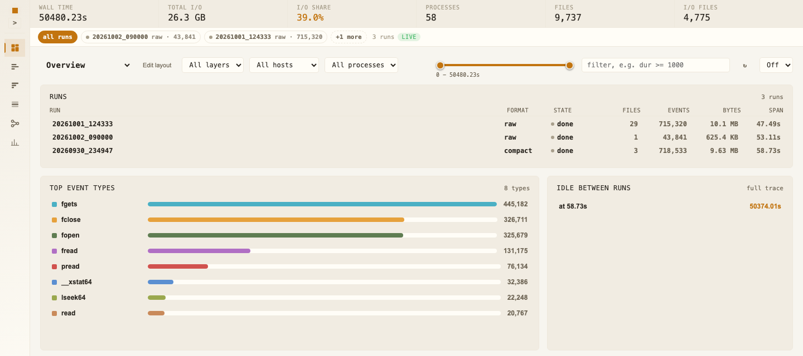
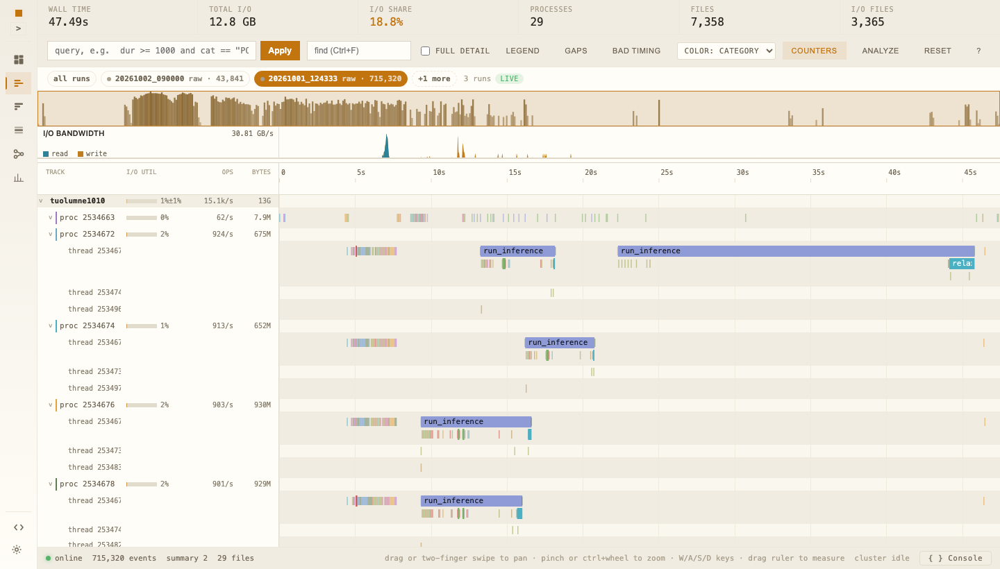

Getting started
===============

This page takes you from a fresh clone to a dashboard you can look at.
You need Python 3.10 or newer, Node 22 and npm.
The steps work the same on macOS and on Linux.

Get the code
------------

.. code-block:: bash

   git clone https://github.com/llnl-asr/dfdashboard.git
   cd dfdashboard

Install the backend
-------------------

A virtual environment keeps the packages apart from the rest of the machine.
Use ``python -m venv .venv`` and ``pip install -e .`` when you do not have uv.

.. code-block:: bash

   uv venv --python 3.10
   source .venv/bin/activate
   uv pip install -e .

The editable install skips the browser build, so the next step does it by hand.
Check that the entry point works. It prints every option and exits.

.. code-block:: bash

   dfdashboard-serve --help

Build the browser app
---------------------

.. code-block:: bash

   cd web
   npm ci
   npm run build
   cd ..

The build writes ``web/dist``.
The next step points the server at that directory, because a source checkout does not carry a bundle of its own.

.. code-block:: bash

   ls web/dist/index.html

Make a trace to look at
-----------------------

You do not need a real trace for this page.
The demo script writes one the way a running application would.

.. code-block:: bash

   python scripts/stream_demo.py --root /tmp/dfd-demo --runs 1 --files 1 --total 40 --split

It ends with ``all runs finished``.
One run appeared below ``/tmp/dfd-demo``, with a raw file, a compact chunk and a marker.

.. code-block:: bash

   find /tmp/dfd-demo -name _SUCCESS

Serve the trace
---------------

.. code-block:: bash

   dfdashboard-serve --trace /tmp/dfd-demo --web-dist web/dist

The server prints its address and keeps running.
Leave it running and use a second terminal for the rest of this page.

Look at the run
---------------

Open http://127.0.0.1:5006 in a browser.
The left rail lists the views, and the bar above the views lists the runs.

The Overview tab holds the run summary and its cards.
The run bar above it lists every run the server found, with the format it reads and the state of each run.

The Timeline tab draws the events on canvas, with one lane for each thread.
Drag to pan and scroll to zoom.
The server answers each new viewport with the events it needs, so nothing loads the whole trace.

Press ``?`` in the app to see the keys and the mouse gestures.
:doc:`shortcuts` lists the same table.
Both images come from the same three runs, and the numbers in them differ from yours.

The Flamegraph tab folds the same window into call paths.
The Analysis tab runs the Dask pipelines over the loaded trace.

Follow a run while it grows
---------------------------

Stop the server with Ctrl-C and start it again over the whole tree.

.. code-block:: bash

   dfdashboard-serve --watch /tmp/dfd-demo --web-dist web/dist

The server rescans the tree and reports each change on ``/api/stream``, so a run that gains files appears without a reload.
:doc:`producing-runs` shows the directory a producer writes for this.
:doc:`runs` lists the rules the server applies to it.
